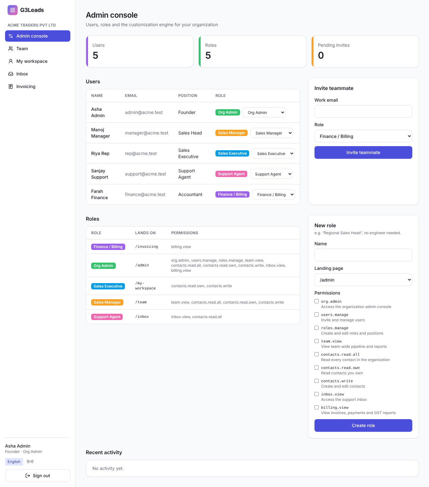
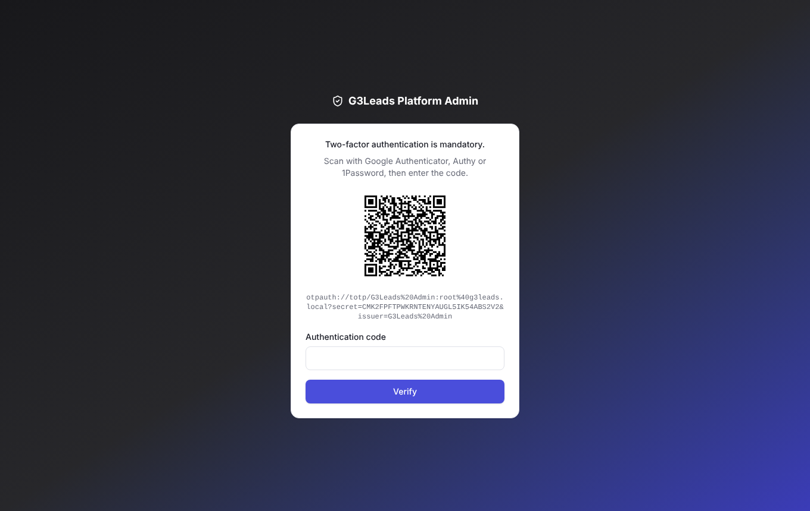

# G3Leads

A multi-tenant B2B CRM **platform** for the Indian market, built on the current
(October 2026) web stack. This repository contains **Phase 0: Foundations**
from the [master build spec](docs/g3leads-master-prompt.md). That covers the
monorepo, tenant auth, a separate super-admin portal with mandatory 2FA, role
and position-based routing, and PostgreSQL Row-Level Security proven across
tenants by automated tests.

| | |
|---|---|
|  |  |

## Stack

| Layer | Choice |
|---|---|
| Monorepo | Turborepo 2.11, pnpm 10 workspaces, Biome 2 (lint + format), TypeScript 7 (native compiler) |
| Tenant app (`apps/web`) | React 19.3, Vite 8 (Rolldown), React Router 8, TanStack Query 5, Zustand 5, i18next (English + हिन्दी) |
| Super-admin app (`apps/admin`) | Separate React 19 + Vite 8 deployable |
| UI kit (`packages/ui`) | Tailwind CSS 4 (CSS-first `@theme` tokens), Radix primitives, lucide icons |
| API (`apps/api`) | Hono 4 + `@hono/zod-openapi` (Zod 4), OpenAPI 3.1 with Scalar docs at `/api/docs` |
| Auth | `jose` JWTs (separate secret **and** audience per portal), rotating refresh tokens with reuse detection, httpOnly cookies, Argon2id, otplib TOTP |
| Data (`packages/db`) | PostgreSQL 18 (16+ works) with Row-Level Security, Drizzle ORM, postgres.js |
| Tests | Vitest 5 (API against real Postgres), Playwright 1.64 (E2E + screenshots) |

## Quick start

```bash
cp .env.example .env
docker compose up -d                # Postgres + Redis (or use a local Postgres)
pnpm install
pnpm db:migrate && pnpm db:seed
pnpm dev                            # api :4000 · web :5173 · admin :5174
```

The seed creates these accounts (dev only, password `Password123!`):

| Who | Login at | Lands on |
|---|---|---|
| `admin@acme.test` (Org Admin) | http://localhost:5173 | `/admin` |
| `manager@acme.test` (Sales Manager) | same page | `/team` |
| `rep@acme.test` (Sales Executive) | same page | `/my-workspace` |
| `support@acme.test` / `finance@acme.test` | same page | `/inbox` / `/invoicing` |
| `root@g3leads.local` (platform admin) | http://localhost:5174 | TOTP enrolment, then tenant console |

API reference: http://localhost:4000/api/docs

## Scripts

| Command | What it does |
|---|---|
| `pnpm dev` | Run API, web and admin in watch mode |
| `pnpm test` | API integration tests (needs Postgres with a `g3leads_test` database) |
| `pnpm --filter @g3/e2e e2e` | Playwright E2E against the running stack; writes `docs/screenshots/` |
| `pnpm lint` / `pnpm typecheck` / `pnpm build` | Biome, TypeScript, production builds |

## Phase 0 acceptance criteria

All of these are checked by automated tests, not by hand:

- **Two orgs are isolated.** See `apps/api/test/tenant-isolation.test.ts`. It
  checks through the API, and also directly against PostgreSQL as the
  `g3_app` role. Other tenants' rows are invisible. With no tenant context the
  role sees nothing. Writing a row tagged with another org fails RLS
  `WITH CHECK`.
- **The two portals can't use each other's tokens.** See
  `apps/api/test/portal-separation.test.ts`. A super-admin token gets 401 on
  every tenant endpoint, and a tenant token gets 401 on the admin API. Tokens
  forged with the wrong secret or audience are rejected. The MFA challenge
  token is not accepted as an access token. The platform DB role can't read
  tenant contacts.
- **Three roles, one login page, three dashboards, enforced server-side.**
  See `apps/api/test/rbac-routing.test.ts` and `e2e/tests/tenant.spec.ts`.
  This also covers custom roles created at runtime, record-level
  "own vs all" scoping, refresh-token rotation and reuse detection, and CSRF.

## Repository layout

```
apps/
  api/      Hono API: /api/v1 (tenant) and /admin-api/v1 (platform), tests in test/
  web/      tenant SPA: login, signup, invites, role dashboards
  admin/    super-admin SPA: password + TOTP, tenant console
packages/
  db/       SQL migrations (RLS, DB roles, auth functions) + Drizzle schema
  shared/   permission catalogue, default roles, Zod schemas
  ui/       Tailwind 4 design tokens + components
e2e/        Playwright specs
docs/       architecture notes, master build spec, screenshots
```

See [docs/architecture.md](docs/architecture.md) for the design decisions and
the roadmap for Phases 1–6.

> GST, e-invoicing and DPDP Act logic in later phases must be reviewed by a
> CA/tax professional and a lawyer before production use.
